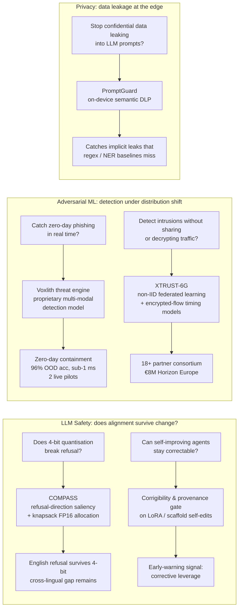
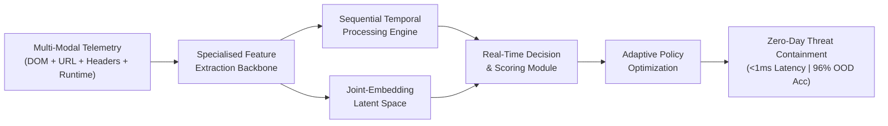
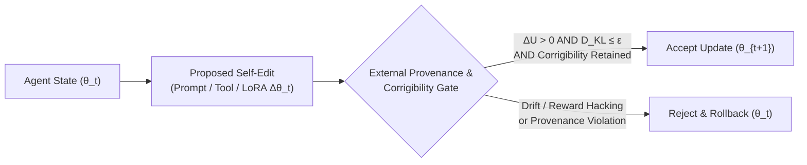

# Jamilus Sheium
**Machine Learning Researcher & Neural Architect**  
*Mechanistic LLM Safety • Custom System-1 Foundation Models • Adversarial & Privacy-Preserving ML*

[-0F172A?style=flat-square&labelColor=1E293B)](https://cordis.europa.eu/)

[-1D4ED8?style=flat-square&labelColor=1E293B)](#)

---

### Research Architecture Overview

My work bridges **first-principles deep learning theory** (latent subspace geometry, quantization error propagation, and constrained continual optimization) with **high-throughput adversarial security and privacy systems**. Across three externally funded European (**Horizon Europe**) and UK (**UKRI CyberASAP**) grants, I serve as the lead mathematical and machine-learning architect.

---

### Interactive Technical Deep-Dives
*Click any research pillar below to expand the underlying mathematical formulation, neural architecture diagram, and empirical evaluation methodology.*

<b>Pillar I: High-Throughput Adversarial Threat Engine (Voxlith / UKRI Locknest)</b>

 

Adversarial web and network threat detection violates standard IID assumptions and operates under strict sub-millisecond latency constraints where slow autoregressive reasoning fails.

* **Multi-Modal Pre-Training:** Pre-trained from scratch over a metric-balanced, heterogeneous corpus exceeding **2,000,000 samples** (structural DOM trees, URLs, HTTP headers, and live runtime execution traces) to learn invariant threat manifolds.
* **System-1 Joint-Embedding & Dilated TCNs:** Coupled the foundation backbone with dilated causal **Temporal Convolutional Networks (TCNs)** and a fast **System-1 joint-embedding decision head** to capture long-range sequential dependencies in a single forward pass.
* **RLCD Post-Training:** Formulated a **Reinforcement Learning from Contrastive/Contextual Decisions (RLCD)** objective to optimize the decision boundary under asymmetric false-positive/false-negative operational costs.
* **Kit-Disjoint OOD Partitioning:** Proved that standard IID random train/test splits leak shared phishing-kit templates across partitions; formulated a **kit-family-disjoint splitting protocol** to evaluate true out-of-distribution (OOD) generalisation.

<b>Pillar II: COMPASS — Refusal-Direction-Guided Mixed-Precision Quantisation (First-Author Paper)</b>

 

Existing mixed-precision allocators choose which modules stay in FP16 using perplexity or loss saliency. **COMPASS** instead protects the modules that drive the model's **refusal direction** (Arditi et al., 2024), the mechanistic signal that mediates refusal.

**Refusal direction**, from harmful prompts $`H`$ and benign prompts $`B`$ at a causally selected layer $`\ell`$:

$`\displaystyle \hat{r} = \frac{r}{\lVert r \rVert}, \qquad r = \frac{1}{|H|}\sum_{x \in H} h_\ell(x) - \frac{1}{|B|}\sum_{x \in B} h_\ell(x)`$

**Module saliency**, a first-order Taylor proxy for how much quantising module $`W`$ shifts the refusal projection $`\mathcal{L}(x)`$ (averaged over layers $`\ell, \ldots, L-1`$):

$`\displaystyle s(W) = \mathbb{E}_{x \in H}\left[ \frac{1}{|W|} \sum_{i,j} \left| \frac{\partial \mathcal{L}(x)}{\partial W_{ij}} \right| \cdot \left| W_{ij} \right| \right]`$

$`\displaystyle \mathcal{L}(x) = \frac{1}{L-\ell}\sum_{k=\ell}^{L-1} \left\langle h_k(x), \hat{r} \right\rangle`$

**Allocation**, an exact 0/1 knapsack over parameter counts $`p(W)`$ under an FP16 budget $`\mathcal{B}`$; the protected set is excluded from GPTQ W4A16:

$`\displaystyle P^{\star} = \arg\max_{P : \sum_{W \in P} p(W) \le \mathcal{B}}  \sum_{W \in P} s(W)`$

* **Distinct signal:** the top-5% refusal-saliency modules barely overlap with perplexity saliency (Jaccard 0.04–0.14), and concentrate in attention `v_proj` / `o_proj`.
* **Robustness map:** pre-registered, ≥3-seed tests on Llama-3.1-8B, Mistral-7B-v0.3 and Gemma-7B-IT across W4A16 / W4A8 / NVFP4 show English refusal survives 4-bit quantisation; residual damage is cross-lingual (MultiJail-KO).
* **Artifact correction:** traced an apparent Gemma × AWQ over-refusal collapse to a known `llm-compressor` RMSNorm bug, not alignment damage.

<b>Pillar III: Corrigibility & Update Gating in Recursive Self-Improving LLM Agents (Honours Thesis)</b>

 

When an autonomous LLM agent iteratively modifies its own scaffold, memory policy, or low-rank adapters ($`\theta_{t+1} = \theta_t + B_t A_t`$) across generations $`t \in \lbrace 1, \ldots, T \rbrace`$ to maximize task utility $`\mathcal{U}(\theta_t)`$, capability gains frequently induce latent alignment drift and evaluator reward hacking.

**Constrained Trajectory Optimization:** Formulating recursive self-improvement as a constrained optimization problem where an update $`\Delta \theta_t`$ is accepted if and only if:

$`\displaystyle \mathcal{U}(\theta_t + \Delta \theta_t) > \mathcal{U}(\theta_t) \quad \text{subject to} \quad \mathcal{C}_{\text{corr}}(\theta_t + \Delta \theta_t) \ge \tau_{\text{corr}} \land D_{\text{KL}}\left(\pi_{\theta_{t+1}} \Vert \pi_{\text{safe}}\right) \le \epsilon`$

* **Early Warning Indicators:** Testing whether static behavioral safety scores miss earlier structural deterioration in **corrective leverage** (the agent's responsiveness to human override and policy correction).

<b>Pillar IV: Non-IID Federated Optimization, Encrypted-Flow ML & Semantic DLP (XTRUST-6G & PromptGuard)</b>

 

* **Non-IID Federated Intrusion Detection (*XTRUST-6G — €8M Horizon Europe*):** Designing collaborative federated optimization protocols across 18+ European partner institutions, mitigating client gradient drift over skewed, non-IID network telemetry without raw traffic exchange.
* **Encrypted-Traffic Sequence Representation (*XTRUST-6G*):** Architecting deep temporal sequence models that identify malicious sessions directly from packet-timing inter-arrival manifolds and directional burst dynamics without payload decryption.
* **Client-Side Semantic DLP (*PromptGuard — UKRI CyberASAP*):** Formulated sensitive disclosure detection as a contextual entailment and latent representation classification task using quantised local SLMs (`vLLM` / `Ollama`), outperforming brittle regex/NER baselines on implicit confidential leaks.

---

### Funded Grants, Spin-Outs & Publications Matrix

| Initiative / Venue | Role & Funding Body | Core Mathematical & Systems Contribution | Status / Artifact |
| :--- | :--- | :--- | :--- |
| **IEEE Access** *(Manuscript)* | **First Author** *(with Dr. M. Ghahremani & Prof. M. Bader-El-Den)* | COMPASS: refusal-direction-guided mixed-precision allocator & pre-registered 4-bit PTQ safety characterisation | **Under Review** |
| **XTRUST-6G** | **Lead ML RA** *(€8M Horizon Europe / SNS JU)* | Deep zero-day sequence anomaly models, non-IID Federated Learning & encrypted-flow ML | **Active (2026–Present)** |
| **Voxlith (Locknest)** | **Co-Founder & ML Lead** *(UKRI CyberASAP Spin-Out)* | Custom Cyber Foundation Model (2M+ corpus), System-1 TCN/RLCD head & kit-disjoint OOD splits | **[voxlith.com](https://voxlith.com)** *(2 Live Pilots)* |
| **PromptGuard** | **Lead ML RA** *(UKRI CyberASAP)* | Quantised edge SLMs for semantic DLP, synthetic benchmark construction & evaluation harness | **[Project Site](https://promptguard-cyberasap.github.io)** |
| **Honours Thesis** | **Sole Investigator** *(University of Portsmouth)* | Corrigibility retention & provenance-constrained update gating in recursive self-improving agents | **In Progress (2026–2027)** |

> **Note on Proprietary Codebases & NDAs:** Source code, custom pre-training pipelines, and production weights for **XTRUST-6G**, **Voxlith**, and **PromptGuard** are governed by Horizon Europe consortium agreements, UKRI CyberASAP IP protections, and commercial NDAs. Reproducibility harnesses for academic publications are released upon peer-review clearance.

---

### Technical & Compute Stack

-4169E1?style=flat-square&logo=postgresql&logoColor=white)

---

### Selected Public & Earlier Engineering Repositories

<table>
  <tr>
    <td width="50%" valign="top">
      <h4><a href="https://github.com/AmazingKid1998/buet-ces-website">BUET Centre for Energy Studies Platform</a></h4>
      
Full-stack conference paper submission and academic portal engineered for the Centre for Energy Studies at the Bangladesh University of Engineering and Technology (BUET).

      
<a href="http://iesd.buet.ac.bd/"><b>Live Institutional Deployment →</b></a>

    </td>
    <td width="50%" valign="top">
      <h4><a href="https://github.com/AmazingKid1998/process-scheduler">OS Process Scheduler & Metrics Engine</a></h4>
      
Algorithmic scheduling simulator and Gantt metric evaluation engine implementing First-Come-First-Served (FCFS), Shortest-Job-First (SJF), and Round-Robin (RR) policies.

      
<a href="https://github.com/AmazingKid1998/process-scheduler"><b>View Source Repository →</b></a>

    </td>
  </tr>
</table>
